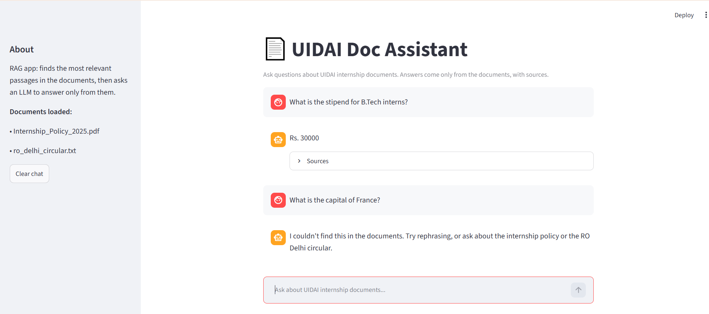

# AskTheDocs

A Retrieval-Augmented Generation (RAG) chat app that answers questions from your own PDF or text documents and shows the source page behind every answer.

> Independent student project, not affiliated with UIDAI. The demo documents are the publicly available UIDAI Internship Policy 2025 and a UIDAI RO Delhi internship circular (as a text file).



## Why this project
Long policy documents are slow to search, and a plain chatbot can confidently invent answers. AskTheDocs only answers from the documents you give it, shows which page the answer came from, and says so when the answer is not in the documents.

## Features
- **Answers with sources:** every answer comes with the retrieved passages, their file name, page number and a match score.
- **Out-of-scope guardrail:** if the best match score is below a threshold, the app replies "not found in the documents" and does not call the LLM.
- **Upload your own documents:** add PDF or .txt files from the sidebar and chat with them in the same session. You can search in all documents or only in your uploads.
- **Chat interface:** Streamlit chat UI with history, a loaded-documents list and a "Clear chat" button.
- **Reliable API usage:** retries when the Gemini API is busy, falls back to other models, and shows the retrieved passages if no model is available.

## How it works
1. **Ingest** (`ingest.py`): reads PDFs and text files from `docs/` and splits them into overlapping chunks (800 characters, 150 overlap).
2. **Embed:** converts each chunk into a vector using `all-MiniLM-L6-v2` (Sentence-Transformers) and saves the index to `index.pkl`.
3. **Retrieve:** embeds the question and picks the top 4 chunks by cosine similarity (NumPy).
4. **Guardrail:** if the best score is below `MIN_SCORE` (0.25), no LLM call is made.
5. **Generate:** the retrieved chunks are sent to the Gemini API with an instruction to answer only from that context, or say it does not know.
6. **Display:** the answer is shown in a chat bubble with an expandable "Sources" section.

## Tech stack
Python, pypdf, Sentence-Transformers, NumPy, Google Gemini API (`google-genai`), Streamlit

## Project structure
```
AskTheDocs/
├── app.py              # Streamlit web app (chat UI, upload, guardrail)
├── ask.py              # Terminal version + shared functions (prompt, retry, model fallback)
├── ingest.py           # Reads documents in docs/, chunks, embeds, saves index.pkl
├── list_models.py      # Lists the Gemini models available for your API key
├── requirements.txt
├── docs/               # Demo documents (public UIDAI files)
└── screenshot.png
```
`index.pkl` is generated by `ingest.py` and is not stored in the repository.

## Run it locally
**1. Install dependencies**
```bash
pip install -r requirements.txt
```

**2. Get a Gemini API key** from [Google AI Studio](https://aistudio.google.com) and set it as an environment variable named `GEMINI_API_KEY`. Never put the key in the code or commit it.

Windows (PowerShell), saved permanently (restart your terminal or editor afterwards):
```powershell
setx GEMINI_API_KEY "your_key_here"
```
macOS / Linux:
```bash
export GEMINI_API_KEY="your_key_here"
```

**3. Add documents** (PDFs with real text, or .txt files) to the `docs/` folder and build the index:
```bash
python ingest.py
```
Run this again whenever the documents in `docs/` change.

**4. Start the app**
```bash
python -m streamlit run app.py
```
Streamlit opens the app in your browser at `http://localhost:8501`. A plain `python app.py` will not start the web page; use the command above.

Terminal version:
```bash
python ask.py
```

**Model names:** Gemini model names change over time. The models tried by the app are listed in `LLM_MODELS` in `ask.py`. Run `python list_models.py` to see which names your key can use.

## Example questions (demo documents)
- What is the monthly stipend for B.Tech interns?
- What is the minimum duration of an internship?
- How many technical interns will UIDAI RO Delhi take?
- What is the last date to apply to RO Delhi?
- What is the capital of France? (should be declined: not in the documents)

## Limitations and next steps
- **Scanned PDFs are not read.** They have no text layer, so `pypdf` cannot extract text from them. Planned: OCR (for example Tesseract).
- **Uploaded documents live only for the current browser session** and are not saved to the index.
- **The score threshold is a hand-tuned value**, not a learned one.
- **Planned:** an evaluation set of questions with expected answers to measure accuracy, and hybrid keyword + vector search.

## Privacy note
Retrieved text from your documents is sent to the Gemini API to generate answers. Do not upload personal, confidential or identity documents.
